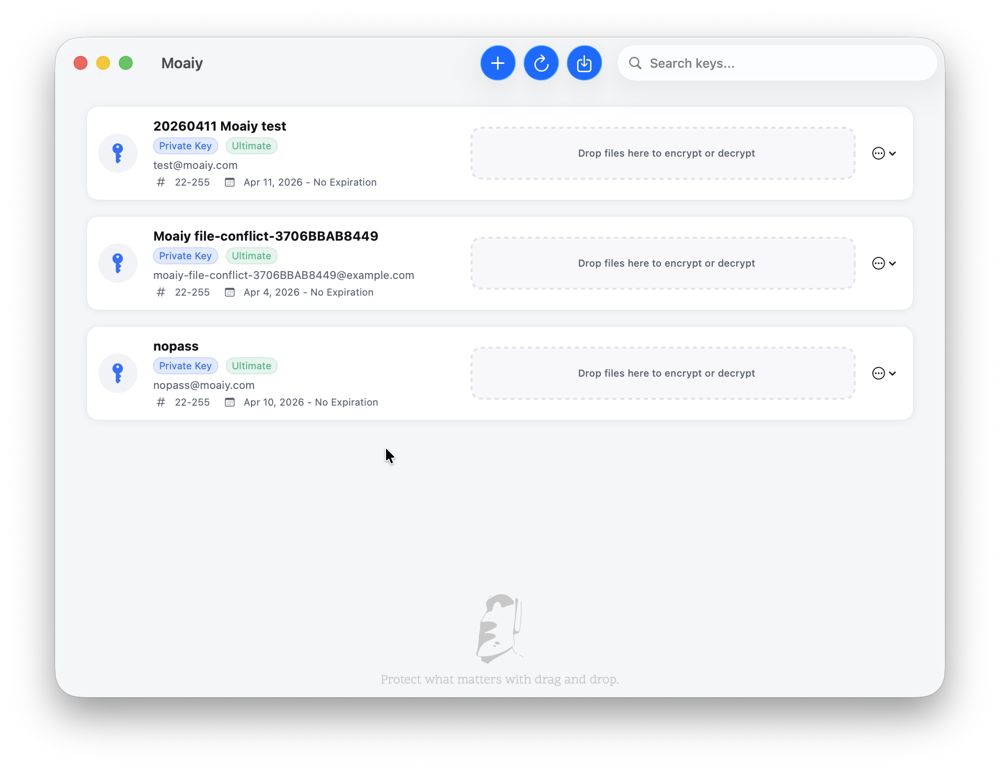

# Moaiy

> 通过拖放，保护你最重要的信息。

Moaiy 帮你通过简单、易操作的步骤保护重要信息。

Moaiy 是一个开源的 macOS 原生应用，专注于加密与恢复工作流，使用 SwiftUI 构建。

**[English Version](./README.md)**

当前稳定版本：`v1.0.1`
当前发布重点：大文件流式加解密管道、系统钥匙串与 Touch ID 口令集成、`moaiy` 命令行伴侣工具，以及 Kyber-768 混合抗量子加密

## 应用截图



## v1.0.0 主要升级

Moaiy v1.0.0 正式发布首个 GA 稳定版，引入恒定低内存开销的流式加解密管道、macOS 系统钥匙串与 Touch ID 生物识别集成、独立的 `moaiy` 命令行伴侣工具，以及针对 macOS App Sandbox 深度加固的安全原地覆盖机制。

- **大文件流式加解密管道（`StreamingCryptoPipeline`）**：采用 256KB 分块流式 I/O、独立 `stdinQueue`/`stdoutQueue` 双队列 8MB 背压限流、分块 `autoreleasepool` 及时释放（64MB 流式实测峰值 RSS 增量 `< 32MB`），并通过 `0600` 权限独立口令令牌文件实现口令与数据流隔离。
- **沙盒安全的原地覆盖机制（`commitStagedFile`）**：通过 POSIX `statfs` 预检扣除被覆盖文件后的净需磁盘空间，采用 `open(O_WRONLY)` 权限预检、容器回滚备份（`original.bak` 清零销毁）以及 `ftruncate` + 流式写入 + `fsync` 原地覆盖，在保留 `NSSavePanel` 沙盒授权与目标文件 inode 的同时确保任何权限或 I/O 异常下原文件零丢失。
- **系统钥匙串与 Touch ID 集成（`KeychainService`）**：基于 macOS Data Protection Keychain 与 `LocalAuthentication`（`.userPresence`）安全存取私钥口令，支持 Touch ID、Apple Watch 与系统密码回退，并提供单次子进程调用的主钥/子钥指纹解析（`resolvePrimaryFingerprint`）。
- **内存清零与临时文件生命周期管理（`SecureMemory` & `TransientFileRegistry`）**：通过 Darwin `memset_s` 在释放时清零敏感字节缓冲区，并在应用正常退出（`willTerminateNotification`）或启动自检时自动清零覆写并清理暂存目录。
- **命令行伴侣工具（`moaiy`）**：新增独立 `MoaiyCLI` 可执行程序，完整支持 `status`（含 Kyber-768 抗量子算法检测）、`list-keys`、`encrypt` 与 `decrypt` 子命令。
- **内置抗量子混合加密支持（`v0.9.0`+）**：内置 GnuPG 2.5.21 运行时（`gpg.bundle`），原生支持生成和使用 Kyber-768 混合 OpenPGP 密钥及传统 ECC / RSA-4096 密钥。

## 功能特性

- 生成、导入、导出和删除密钥（支持 ECC、RSA-4096、RSA-2048 与 Kyber-768 混合抗量子密钥）
- 文本加解密与恒定低内存的大文件流式加解密
- macOS 系统钥匙串与 Touch ID 私钥口令安全托管
- 独立 `moaiy` 命令行伴侣工具，便于终端与自动化脚本调用
- 信任管理、子密钥生命周期管理、Ownertrust 导出/导入、吊销证书与密钥签名流程
- 备份与恢复工作流（含完整性校验）
- 内置 GnuPG 2.5.21 运行时（`gpg.bundle`），无需外部依赖即可在 macOS 沙盒中开箱即用

## 环境要求

- macOS 14.0+（应用运行环境）
- 支持 macOS 14+ SDK 的 Xcode

## 快速开始

### 方式 1：下载发布版本

- 从 [GitHub Releases](https://github.com/moaiy-com/moaiy/releases) 下载最新 `.dmg`
- Apple Silicon 芯片 Mac：`Moaiy-1.0.0-macos-apple-silicon.dmg`
- Intel 芯片 Mac：`Moaiy-1.0.0-macos-intel-chip.dmg`

### 方式 2：源码构建

```bash
git clone https://github.com/moaiy-com/moaiy.git
cd moaiy
open Moaiy/Moaiy.xcodeproj
```

或使用命令行构建 `Moaiy` 与 `MoaiyCLI`：

```bash
xcodebuild -project Moaiy/Moaiy.xcodeproj \
           -scheme Moaiy \
           -destination 'platform=macOS,arch=arm64' \
           build

xcodebuild -project Moaiy/Moaiy.xcodeproj \
           -target MoaiyCLI \
           -configuration Release \
           build
```

## 命令行伴侣工具（`moaiy`）

```bash
moaiy status
moaiy list-keys --secret
moaiy encrypt --recipient <FINGERPRINT_OR_EMAIL> --input secret.txt --output secret.txt.gpg --armor
moaiy decrypt --input secret.txt.gpg --output secret.txt
```

## DMG 打包

使用一条命令完成构建并生成带时间戳的 DMG：

```bash
./scripts/package_dmg.sh
```

或运行双架构（`arm64` + `x86_64`）完整发布编排脚本（自动生成双架构 DMG、`SHA256SUMS.txt`、`release-manifest.json` 与双语 `release-notes.md`）：

```bash
./scripts/release/run_release.sh --version 1.0.0 --mode draft --signing auto --gate balanced
```

常用单架构打包参数：

```bash
./scripts/package_dmg.sh --configuration Release --arch arm64 --version 1.0.0 --artifact-name Moaiy-1.0.0-macos-apple-silicon.dmg
./scripts/package_dmg.sh --configuration Release --arch x86_64 --version 1.0.0 --artifact-name Moaiy-1.0.0-macos-intel-chip.dmg
./scripts/package_dmg.sh --skip-build --open
```

## 运行测试

```bash
# 运行完整 Xcode 单元与集成测试套件（451 项测试）
xcodebuild test -project Moaiy/Moaiy.xcodeproj \
                -scheme MoaiyTests \
                -destination 'platform=macOS,arch=arm64'

# 或运行 5 阶段完整闭环验证脚本（SwiftLint + CLI + 64MB 流式压测 + MoaiyTests）
bash scripts/loop-runner.sh
```

## 内置 GPG 工作流

如果需要刷新内置 GPG bundle，可执行：

```bash
./scripts/prepare_gpg_bundle.sh
./scripts/verify_gpg_bundle.sh
```

如果尚未将 bundle 添加到 Xcode，可执行：

```bash
./scripts/add_gpg_bundle_to_xcode.sh
```

## 仓库结构

```text
moaiy/
├── Moaiy/                  # 主 macOS SwiftUI 应用与 MoaiyTests 测试套件
├── MoaiyCLI/               # 独立 moaiy 命令行伴侣工具
├── MoaiySandboxTest/       # 沙盒验证项目
├── specs/                  # v1.0 核心工程规约文档
├── scripts/                # 构建、闭环验证与 DMG 发布脚本
├── doc/                    # 技术与发布文档
├── CONTRIBUTING.md
├── DISCLAIMER.md
├── README_CN.md
└── LICENSE
```

## 文档

- [贡献指南](./CONTRIBUTING.md)
- [文档索引](./doc/README.md)
- [v1.0.0 发布验证总结](./doc/v1.0.0-release-validation-summary.md)
- [v1.0.0 综合测试计划](./doc/v1.0.0-comprehensive-test-plan.md)
- [v1.0.0 发布说明（Release Notes）](./doc/v1.0.0-release-notes.md)
- [发布流程说明](./doc/release-workflow-skill.md)
- [技术架构](./doc/technical-architecture.md)
- [技术验证状态](./doc/technical-validation-status.md)
- [Xcode 集成指南](./doc/xcode-integration-guide.md)
- [内置 GPG 概览](./doc/bundled-gpg-summary.md)
- [更新日志](./CHANGELOG.md)

## 本地化

- UI 语言：English、简体中文、西班牙语、葡萄牙语（巴西）、印地语、阿拉伯语、法语、德语、日语、韩语、俄语
- 字符串资源：`Moaiy/Resources/Localizable.xcstrings`

## 安全

如果发现安全问题，请优先使用 [SECURITY.md](./SECURITY.md) 中说明的私下披露渠道，而不是公开提交 Issue。

## 许可证

MIT，详见 [LICENSE](./LICENSE)。

## 免责声明

关于密钥管理、密钥泄漏、信息暴露与财产损失等风险边界，请查看 [DISCLAIMER.md](./DISCLAIMER.md)。
